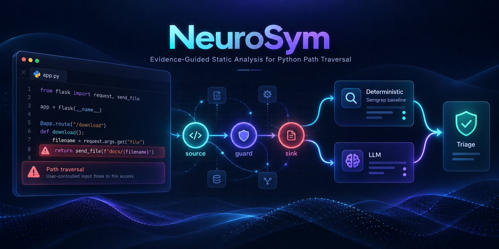

<p align="center"></p>

# Evidence-Checked LLM Triage for Python Path-Traversal Warnings

Yufan (A0238993J) · CS6215 Advanced Topics in Program Analysis, NUS, Fall 2026

A comparative static-analysis study. A symbolic baseline (Semgrep CE taint analysis) reports possible CWE-22 path traversals in Python. Four refinement configurations then try to remove false warnings without discarding real vulnerabilities:

| Arm | What it is |
|---|---|
| **S** | Semgrep CE 1.182.1 with a project-authored, frozen taint rule (`baseline/rules/cwe22-taint.yaml`) |
| **D** | S, then our deterministic recognizers only (constant/overwrite, infeasible branch, normalised containment under a trusted root) |
| **L** | S, then ordinary LLM triage of the enclosing function |
| **E** | S, then LLM triage over our structured evidence (definitions, branch feasibility, dominating guards) and four obligations |
| **EC** | E's *same* responses, then an evidence gate: a suppression stands only if its cited evidence is consistent with the extracted facts (dependency consistency, not value identity) |

All arms consume the same baseline warnings, so no arm can exceed S's recall. The study measures the trade-off between **false-positive removal** and **true-positive retention**. Protocol: [`docs/protocol.md`](docs/protocol.md). Design iterations, including failed ones: [`docs/decisions.md`](docs/decisions.md).

## Layout

| Path | Contents |
|---|---|
| `baseline/rules/` | Frozen Semgrep rule (project-authored; mirrors the policy in `src/neurosym/evidence.py`) |
| `src/neurosym/evidence.py` | Deterministic intraprocedural evidence extractor (value analysis with constant folding, branch pruning, loop fixpoint, guard coverage) |
| `src/neurosym/refine.py` | Arm D recognizers and the EC evidence gate |
| `src/neurosym/triage.py`, `src/neurosym/prompts/` | Arms L and E: prompts (version `p2`), JSON validation, one schema-repair retry |
| `src/neurosym/llm.py` | SoCLaaS client: cached by request + replicate ID, every call logged |
| `src/neurosym/pipeline.py`, `cli.py` | Runs all arms on a subject set; refuses test data unless the `protocol-freeze` tag holds |
| `src/neurosym/scoring.py`, `tables.py`, `stability.py` | Metrics with family-cluster bootstrap; report tables; fresh-replicate stability |
| `data/owasp_split.csv` | Frozen family-grouped dev/test split of OWASP Benchmark for Python CWE-22 cases |
| `data/diagnostics/` | 36 paired programs (12 dev, 24 held-out), generator, manifest, mechanical label validation |
| `src/neurosym/realworld.py`, `data/realworld/` | PyVul CWE-22 screening, selected targets, file snapshots |
| `results/runs/<run>/` | Per run: raw Semgrep JSON, alerts, evidence records, per-arm decisions (with raw model output), scores, manifest |
| `results/llm_calls.jsonl` | One line per LLM call: served model, backend fingerprint, tokens, latency, cache hit, retries |
| `results/tables/`, `report/tables/` | Generated tables (Markdown / LaTeX) |
| `tests/` | 99 regression tests (offline; no API needed), including the counterexamples from both reviews |
| `report/` | ACM `sigconf` report source |

## Setup

Requirements: macOS or Linux, Python ≥ 3.11 (developed on 3.14.0), git, internet for the first fetch. No GPU or Java.

```bash
python3 -m venv .venv
.venv/bin/pip install -e . semgrep==1.182.1 pytest
# third-party subjects at the pinned revisions used in the report
mkdir -p data/downloads && cd data/downloads
git clone https://github.com/OWASP-Benchmark/BenchmarkPython && git -C BenchmarkPython checkout f1291485808b66e20ddb6b01b10dc71b3df8c8ba
git clone https://github.com/billquan/PyVul && git -C PyVul checkout 1172bfd1579b4ad2a524549412170d08ca618fb3
git clone https://github.com/semgrep/semgrep-rules && git -C semgrep-rules checkout 16b9e6d45f10649f6a531ec4838ed9924372c3bc
cd ../..
.venv/bin/python -m pytest -q tests           # 99 offline tests (2 need Semgrep, 2 the OWASP download)
```

LLM experiments use NUS SoCLaaS, an OpenAI-compatible API that is free for SoC users and needs the NUS network or VPN. Copy `.env.example` to `.env` and set `SOCLAAS_API_KEY`, then check access with `.venv/bin/python scripts/smoke_llm.py`.

## Reproducing the results

There are three levels, from cheapest to most complete. Archived runs are never overwritten: `run` refuses an existing name, so every replay needs a new one.

**1. Audit the saved results (no API, no Semgrep, no cache).** Every reported number is regenerated from the run directories in `results/runs/`, and the extractor can be re-checked against the archived evidence.

```bash
.venv/bin/python -m neurosym.cli tables            # results/tables/ and report/tables/ from the saved runs
.venv/bin/python scripts/realworld_eval.py         # the real-world table, from the saved runs and the defect mapping
.venv/bin/python scripts/compare_evidence.py       # re-extract every archived alert (needs data/downloads/BenchmarkPython)
```

**2. Replay the current version end to end (Semgrep, no API).** This runs the baseline again, re-extracts all evidence with the corrected extractor and replays the stored model responses. It needs the response cache in `results/llm_cache/` (not committed; it is shared on request) and a clone that has the tags. Correction runs are named `corr-*` and are checked against the latest correction tag, `review-correction-2`.

```bash
N=".venv/bin/python -m neurosym.cli run --correction --offline"
$N --subjects diag:test  --name corr-r2-test-diag-qcn  --model qwen3-coder-next
$N --subjects diag:test  --name corr-r2-test-diag-q9b  --model qwen3.5:9b
$N --subjects owasp:test --name corr-r2-test-owasp-qcn --model qwen3-coder-next
$N --subjects owasp:test --name corr-r2-test-owasp-q9b --model qwen3.5:9b
```

These four runs are archived. On 25 October 2026 they reproduced every per-alert decision of every arm and every score file of the frozen runs `test-*` exactly, with 0 uncached calls, on Windows 11 with Semgrep 1.182.1. A cache miss is an error and never a silent network call. The real-world runs cannot be replayed offline from the shared cache, because 16 of their E prompts were regenerated in the first correction.

**3. Re-run the original frozen protocol.** Check out the tag in a separate worktree and use new run names. Without the cache this calls SoCLaaS again, and the service models may have changed since 22 October 2026, so expect small differences.

```bash
git worktree add ../neurosym-frozen protocol-freeze && cd ../neurosym-frozen
N=".venv/bin/python -m neurosym.cli"   # a venv made in this worktree as in Setup
$N run --subjects owasp:test --name replay-owasp-qcn --model qwen3-coder-next --workers 2
$N run --subjects diag:test  --name replay-diag-qcn  --model qwen3-coder-next --workers 2
```

The frozen responses that produced the reported numbers are stored in each `results/runs/<run>/decisions_{L,E}.jsonl`, so level 1 needs neither the cache nor the API.

**Windows.** The project was developed on macOS and replayed on Windows. `.gitattributes` keeps every checkout in LF, because the baseline hashes subject files byte for byte. Clone the OWASP benchmark with `git -c core.autocrlf=false clone ...` for the same reason. One test, `test_diagnostic_label_evidence`, assumes POSIX paths and fails on Windows.

**Post-review corrections.** Two independent reviews found programs on which the extractor wrongly proved a warning safe. The fixes, 44 regression programs and their effect are in `docs/decisions.md` (D-R1, tag `review-correction-1`, and D-R2, tag `review-correction-2`). The reviews and the responses to them are in `docs/review/`. Neither correction changed an evidence record of the 220 held-out alert slots (`results/corrections/`), so every frozen score stands. The real-world case study uses a manual per-warning defect mapping in `data/realworld/*_adjudication.csv`, and the raw stability replies are in `results/stability_responses.jsonl`.

**Development runs**, used before the freeze and not reported as test results: `dev-offline-D`, `dev-smoke` (prompts p1), `dev-p2`, `dev-final-owasp`, `dev-final-diag`.

## Models

`qwen3-coder-next` (primary; vLLM backend, fingerprint `vllm-0.26.0-1cf708c9`) and `qwen3.5:9b` (small-model check; Ollama backend, `reasoning_effort="none"`). Temperature 0, JSON response format, 2,000 output tokens, at most 12,000 input tokens. See `configs/models.json`. The served model and fingerprint of every call are in `results/llm_calls.jsonl`.

## Licences of third-party subjects

OWASP Benchmark for Python is GPL-3.0; it is not redistributed here, only fetched at a pinned revision. PyVul and the real-world projects are fetched from their original repositories. The course handout is excluded from the repository.
